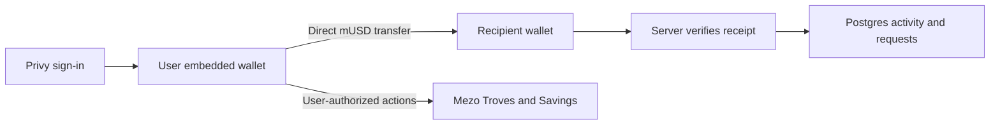

# mUSD Pocket

Send, request and receive mUSD from your own embedded wallet. Borrow against BTC through Mezo Troves and save mUSD in Mezo's sMUSD Savings vault.

Existing app: [mpocket.vercel.app](https://mpocket.vercel.app). Local Wave 1 remediation changes require a separate deployment before they appear there.

## Architecture

Users sign in with X, Telegram or email through Privy. Pocket resolves their embedded wallet and keeps a username directory, payment requests and transaction history in Postgres. Spendable balances come from the wallet on Mezo.

For a payment, the user's embedded wallet signs a direct ERC-20 `transfer` to the resolved recipient. `/api/payments/record` verifies the chain transaction and records the activity. The database records an outcome; it does not authorize a direct payment or create spendable funds. A recording failure after a successful transfer needs recording recovery, not a second transfer or an off-chain refund.



Normal payments do not use `PocketVault`. Legacy vault, ledger and settlement files remain to describe earlier deployments and records; the remediation isolates direct payments from that settlement path. Base and Ethereum references are legacy modeled data, not live cross-chain payment support.

Mezo gas is paid in BTC. Ordinary transfers, borrowing and Savings transactions use the user's wallet and its BTC. Receiving a payment does not require the recipient to sign a transaction. The new testnet faucet round sends **0.06 BTC and 300 mUSD** from the relayer. Previous users can claim again, once per account in this round; previous receipts are preserved. The development-only sponsor endpoint is a transfer harness, not proof of universal gas sponsorship. The welcome reward claim is separately relayed and paid for by Pocket.

## Mezo integration

The default network is **Mezo testnet (31611)**; mainnet is 31612. mUSD has 18 decimals. Configured contracts are in `lib/mezo/config.ts` and `lib/mezo/earn.ts`.

- **Payments:** direct wallet transfers, username resolution and payment requests.
- **Borrow:** open a Trove, read collateral/debt/health, partially repay, or close it. The protocol receives calls authorized by the embedded wallet.
- **Savings:** deposit mUSD, withdraw and claim yield. Total claimable interest includes stored yield plus accrual since the user's last global-index update; the stored `claimableYield(address)` mapping alone can show a false zero.
- **Welcome reward:** one claim of **200 testnet MEZO**, locked for **two weekly epochs** as a recipient-owned veMEZO NFT. The supplied escrow is `0xaCE816CA2bcc9b12C59799dcC5A959Fb9b98111b`. [Configuration and activation](docs/rewards/welcome.md).

The testnet welcome campaign is deployed at `0x3469818359ce1bae2d137531dcd78c5cc4ec14ba` and funded with **200 MEZO, enough for one claim**. [Deployment, funding and real-contract simulation evidence](docs/evidence/welcome-rollout.json). The live Pocket app is configured for it. Claims use the exact weekly expiry, with a wait greater than seven and at most fourteen days. The feature does not guarantee protocol rewards, a fixed APR or human uniqueness among authenticated accounts.

Repay and `claimYield` have code and read-only verification, but their successful on-chain execution evidence still needs to be collected. The October 31 audit corrected the earlier false-zero diagnosis: the supplied wallet had 187.366117347141378 testnet mUSD in claimable Savings yield at the recorded snapshot. This is historical evidence, not a current balance guarantee.

## Local setup

Requires Node.js 22+, pnpm and Postgres.

```bash
pnpm install --frozen-lockfile
cp .env.example .env
```

Set `DATABASE_URL` and `DIRECT_URL`, the Privy app ID/secret, and the selected Mezo network. `RELAYER_PRIVATE_KEY` is server-only and is needed for faucet/reward claims. Fund that wallet with testnet BTC for gas and the corresponding claim assets. Register the local app origin and Mezo chain in Privy.

For a fresh database, review and apply the Prisma schema:

```bash
pnpm exec prisma generate
pnpm exec prisma db push
pnpm dev
```

The live database has legacy schema drift: **do not run `db push` or `--accept-data-loss` against it.** The reviewed [round migration](prisma/sql/2026-10-31-faucet-round-v2.sql) is applied. It labels old rows as `legacy-0.015` and replaces per-user uniqueness with per-user/per-round uniqueness. Do not rerun the old faucet bootstrap SQL after applying the round migration. Ordinary direct payments do not require a PocketVault deployment. The [Wave 1 additive migration](prisma/sql/2026-11-01-wave1.sql) is applied, preserving all existing payment and faucet records. Its [rollout report](docs/evidence/wave1-db-rollout.json) records chain-verified direct-history classification; unreadable history stays unclassified. `POCKET_ENABLE_LEGACY_SETTLEMENT` defaults to false, retiring vault sends, deposits and withdrawals while preserving history. Reward deployment and funding are documented separately.

## Checks

```bash
pnpm exec next typegen
pnpm exec tsc --noEmit
pnpm exec vitest run --config vitest.rewards.config.ts
pnpm build
```

Foundry dependencies and reward tests are documented in [welcome rewards](docs/rewards/welcome.md). Local mocks and fork tests are engineering checks, not on-chain execution or adoption evidence.

## Wave 1 submission

**Track 2: Access and Distribution for MUSD/MEZO.** Pocket reduces friction for people accessing Mezo through social sign-in, embedded wallets, payments, Borrow and Savings. Troves and sMUSD support the product, while access and everyday use define its primary track.

**Proposed revenue:** a disclosed fee on merchant payments, with part of the fee covering sponsored gas. Ordinary peer-to-peer sends remain free of a proposed Pocket fee. Premium merchant tools are a later option. Pricing and commercial demand still need validation; no revenue is claimed.

The [eight-slide pitch deck](docs/submission/pitch-deck.pdf) is available as PDF, with editable [slide content](docs/submission/pitch-deck.json) and a [printable HTML version](docs/submission/pitch-deck.html). It distinguishes implementation and deployment from pending user evidence.

Merchant checkout is implemented at `/merchant`: save a business name, create an invoice, and share its unique `/pay/<id>` link or QR. Customers sign a direct mUSD transfer; authenticated sender, token, recipient, amount and receipt are verified. Invoice polling recovers stored pending payments; a recorded transaction cannot settle two invoices. Closed invoices reject a new payment, and a real transfer received after closure is labelled late paid. The pilot charges no Pocket fee; customers pay BTC gas. Scan QR codes with the phone camera or paste checkout links in Pocket.

Use the [pilot kit](docs/submission/pilot-kit.md), [empty evidence ledger](docs/submission/pilot-evidence.csv), and [on-chain checklist](docs/submission/on-chain-verification.md). Independent user and merchant adoption, repeat usage and repayment/claim-yield receipts remain submission requirements. Welcome claims and wallets controlled by the project owner are not evidence of independent adoption.
