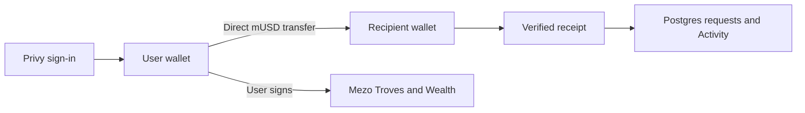

# mUSD Pocket

Borrow mUSD against BTC on Mezo and spend it through social payments and merchant checkout from your own embedded wallet. Manage Savings, swaps, BTC locks and liquidity in the same mobile app.

**App:** [mpocket.tech](https://mpocket.tech/home) · **Network:** Mezo testnet (31611)

**Android:** [mPocket 0.2.5 APK](https://mpocket.tech/downloads/mpocket-0.2.5.apk) · [Release notes](docs/android-0.2.5-handoff.md). Install over the existing app. Vault claims prepare BTC fees before confirmation and recover a lost wallet response without claiming that nothing moved. New locks use BTC; previous MEZO positions remain manageable. Weekly tasks are available immediately, and the testnet faucet supplies starting funds.

**Track:** Track 2 — Access and Distribution for MUSD/MEZO

**Pitch:** [PDF](docs/submission/pitch-deck.pdf) · [editable slides](docs/submission/pitch-deck.json) · [HTML](docs/submission/pitch-deck.html)

**Submission:** [AKINDO fields and dated milestones](docs/submission/akindo-fields.md) · [Wave 2 update](docs/submission/submission.md) · [Merchant pilot record](docs/submission/pilot-record.md)

## How payments work

Sign in with X or email through Privy. Your embedded wallet holds the spendable mUSD and BTC. Pocket stores profiles, payment requests and Activity in Postgres.

The payer reviews the recipient and amount, then signs a direct ERC-20 `transfer`. Pocket verifies the network, sender, token, recipient, exact amount, successful receipt and matching Transfer log before recording the outcome. A saved transaction hash recovers a pending or unrecorded payment without signing another transfer.

Normal payments do not use PocketVault or debit an internal ledger. Legacy vault and modeled cross-chain settlement code remains for earlier records; only explicitly classified legacy payments enter that reconciler. Base and Ethereum are not live cross-chain payment routes in this build.

Mezo gas is paid in **BTC**. Payers pay gas from their own wallets for payments, borrowing, Savings and Wealth. Receiving requires no transaction. The funded testnet faucet sends **0.015 BTC and 300 mUSD** once per account. The welcome reward has ended; universal gas sponsorship is not implemented.

## Wave 2 product

- **Mainnet waitlist:** Send → Verified merchants → Pocket mainnet access opens the 100-testnet-mUSD closed-mainnet pilot checkout. Each wallet reuses its own invoice; pending and completed payments recover when reopened. Payment requires a separate confirmation and does not activate mainnet access.
- **Merchant checkout:** save a Business payment profile, create a payment link or QR and receive mUSD directly. Checkout retains its invoice URL during sign-in, shows the exact recipient and amount, and verifies payment before showing paid. Each invoice keeps its merchant-name snapshot. Business names are self-declared.
- **Recovery:** hashes survive reloads; retries verify the existing transfer. Proof reuse across invoices is blocked, late transfers are shown as late paid, and direct sends stay isolated from legacy refunds.
- **Borrow:** open, inspect, partially repay or close a BTC-backed Trove with the owning wallet. Minimum debt, fees and health are read from Mezo.
- **Savings:** deposit, withdraw and claim yield. Claimable interest includes stored yield and uncheckpointed global-index accrual; unavailable reads stay unknown. Claims report the actual mUSD payout from the receipt. A lost wallet response preserves its hash or reserved nonce; checking confirmation does not request another signature. Explicit retries keep the original nonce so only one claim can execute.
- **Swap:** exchange mUSD with BTC, mUSDC or mUSDT through verified testnet pools, with fees, minimum received, slippage and deadline shown.
- **Wealth:** manage Vault, BTC locks and pools in Pocket. Create, top up, extend and withdraw eligible veBTC positions. The Existing MEZO tab preserves access to previous locks. Pool actions include liquidity add/remove and fee claims.
- **Weekly tasks:** confirmed payments, referrals, borrowing, repayment, liquidity, swaps and BTC locks. Tasks reset weekly and do not promise a token payout.

This build's dock is **Home · Swap · Wealth**. Activity remains under Home → View All. Each approval and final Wealth action needs its own confirmation. BTC lock duration is capped at **30 days** on this testnet contract, with weekly rounding. Starting a permanent BTC lock's unlock sets a date up to 30 days away. Previous MEZO permanent locks retain their 208-week countdown.

Home's total card keeps **mUSD and BTC** prominent. Positive balances of supported mUSDC, mUSDT, MEZO, sMUSD and pool LP tokens appear below. Tokens without a verified valuation show their amount and are excluded from the priced sum; sMUSD contributes its verified 1:1 principal.

[Feature status and activation](docs/mezo-wealth.md) · [Checkout](docs/payment-links.md) · [Recovery](docs/payment-recovery.md) · [Pilot guide](docs/mezo-testing-guide.md)

## Evidence and limits

Two `claimYield` calls were verified against calldata, successful receipts and mUSD Transfer logs:

| Receipt | Testnet mUSD received |
| --- | ---: |
| [0x43149c…08cfdf](https://explorer.test.mezo.org/tx/0x43149c59ae2cafafdc764a234ba6df7050a3981218cebd83ca633caaa608cfdf) | 187.366117347141378 |
| [0x527173…b7a3af](https://explorer.test.mezo.org/tx/0x5271739bb3e06a0f1233efc0ac85df7d9b79e47126242236b28d29a4ecb7a3af) | 0.00228183663115 |

An existing [liquidity addition](https://explorer.test.mezo.org/tx/0xef79292d44ad002722c6e4532abb33d0d679d0240c867c587784391fbd6e9409) also has a successful receipt. These establish specific chain outcomes, not independent adoption or every frontend interaction.

On November 3, the user completed the approved 0.05-BTC / 2,000-mUSD Trove sequence. The [10-mUSD partial repayment](https://explorer.test.mezo.org/tx/0x77596c3ad14f654f73952c2f5dfdcb05bbe8d30e93ff205bc5935ab6d70c31e7) burned exactly 10 mUSD, reduced debt by exactly 10 after accounting for interest accrual, and preserved 0.05 BTC collateral. [Before/after proof](docs/evidence/wave-2-repayment-proof.json).

The first **100-testnet-mUSD closed-mainnet waitlist invoice** was paid on November 3. Its sender is the builder wallet used for the Trove and Savings checks; the invoice and Activity record agree. It demonstrates settlement. Independent customer purchases, fulfillment, feedback and repeat use remain pending. [Payment receipt](https://explorer.test.mezo.org/tx/0x056b918e9620de6ef203312880f6dc6872e8db71ac2d7edf59c58f074a363195) · [Dated November 12 snapshot](docs/evidence/wave-2-pilot-snapshot-2026-11-12.json).

November 13 verification covers Savings/Wealth, wallet identity, profiles, merchants, weekly tasks, retired reward access, checkout, payment recovery and reconciliation. [Android 0.2.5 validation](docs/evidence/android/validation-0.2.5.json) records the test totals, screen checks, claim recovery, build and signing results. Physical Android installation and real account/signing flows remain unverified. BTC contract configuration is checked against Mezo Testnet; local fork lifecycle tests replace the native BTC precompile with a fixture token and do not create a live BTC lock.

[Evidence index](docs/submission/evidence.md) · [Delivery record](docs/submission/delivery.md) · [November 3 baseline](docs/wave-2-status-2026-11-03.md)

## Revenue model

Proposed disclosed fees on successful merchant payments, partly covering BTC gas sponsorship and operations. Ordinary P2P sends are not the initial fee target. Premium merchant reporting and reconciliation tools can follow pilot demand.

Pricing and sponsorship need validation with real merchants and measured costs. This build collects no Pocket fee and claims no revenue. Mezo pool fees shown in Swap/Wealth are not Pocket revenue.
