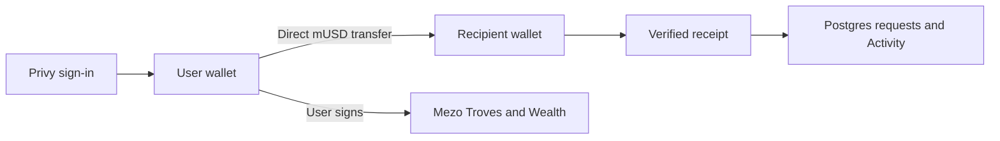

# mUSD Pocket

Send, request and receive mUSD from your own embedded wallet. Borrow against BTC through Mezo Troves and manage Savings, swaps, MEZO locks and liquidity in the same mobile app.

**App:** [mpocket.tech](https://mpocket.tech/home) · **Network:** Mezo testnet (31611)

**Track:** Track 2 — Access and Distribution for MUSD/MEZO

**Pitch:** [PDF](docs/submission/pitch-deck.pdf) · [editable slides](docs/submission/pitch-deck.json) · [HTML](docs/submission/pitch-deck.html)

## How payments work

Sign in with X, Telegram or email through Privy. Your embedded wallet holds the spendable mUSD and BTC. Pocket stores profiles, payment requests and Activity in Postgres.

The payer reviews the recipient and amount, then signs a direct ERC-20 `transfer`. Pocket verifies the network, sender, token, recipient, exact amount, successful receipt and matching Transfer log before recording the outcome. A saved transaction hash recovers a pending or unrecorded payment without signing another transfer.

Normal payments do not use PocketVault or debit an internal ledger. Legacy vault and modeled cross-chain settlement code remains for earlier records; only explicitly classified legacy payments enter that reconciler. Base and Ethereum are not live cross-chain payment routes in this build.

Mezo gas is paid in **BTC**. Payers pay gas from their own wallets for payments, borrowing, Savings and Wealth. Receiving requires no transaction. The funded testnet faucet sends **0.015 BTC and 300 mUSD** once per account. Welcome rewards are separately relayed; universal gas sponsorship is not implemented.

## Wave 2 product

- **Merchant checkout:** save a Business payment profile, create a payment link or QR and receive mUSD directly. Checkout retains its invoice URL during sign-in, shows the exact recipient and amount, and verifies payment before showing paid. Each invoice keeps its merchant-name snapshot. Business names are self-declared.
- **Recovery:** hashes survive reloads; retries verify the existing transfer. Proof reuse across invoices is blocked, late transfers are shown as late paid, and direct sends stay isolated from legacy refunds.
- **Borrow:** open, inspect, partially repay or close a BTC-backed Trove with the owning wallet. Minimum debt, fees and health are read from Mezo.
- **Savings:** deposit, withdraw and claim yield. Claimable interest includes stored yield and uncheckpointed global-index accrual; unavailable reads stay unknown.
- **Swap:** exchange mUSD with BTC, mUSDC or mUSDT through verified testnet pools, with fees, minimum received, slippage and deadline shown.
- **Wealth:** manage Vault, MEZO locks and pools in Pocket. Lock creation, top-up, extension, expired withdrawal and permanent-lock lifecycle; pool liquidity add/remove and fee claims.
- **Welcome:** **20 testnet MEZO** per account and wallet, locked into a user-owned veMEZO NFT for two weekly epochs (7–14 days after rounding). The first claim is verified: NFT #941, 20 MEZO, recipient ownership, and `AlreadyClaimed` on a read-only replay. The campaign retains 80 MEZO for four claims.

This build's dock is **Home · Swap · Wealth**. Activity remains under Home → View All. Each approval and final Wealth action needs its own confirmation. Permanent-lock Start unlock begins a new **208-week countdown**.

Home's total card keeps **mUSD and BTC** prominent. Positive balances of supported mUSDC, mUSDT, MEZO, sMUSD and pool LP tokens appear below. Tokens without a verified valuation show their amount and are excluded from the priced sum; sMUSD contributes its verified 1:1 principal.

[Feature status and activation](docs/mezo-wealth.md) · [Checkout](docs/payment-links.md) · [Recovery](docs/payment-recovery.md) · [Pilot guide](docs/mezo-testing-guide.md)

## Evidence and limits

Multiple `claimYield` calls were verified against calldata, successful receipts and mUSD Transfer logs:

| Receipt | Testnet mUSD received |
| --- | ---: |
| [0x43149c…08cfdf](https://explorer.test.mezo.org/tx/0x43149c59ae2cafafdc764a234ba6df7050a3981218cebd83ca633caaa608cfdf) | 187.366117347141378 |
| [0x527173…b7a3af](https://explorer.test.mezo.org/tx/0x5271739bb3e06a0f1233efc0ac85df7d9b79e47126242236b28d29a4ecb7a3af) | 0.00228183663115 |

An existing [liquidity addition](https://explorer.test.mezo.org/tx/0xef79292d44ad002722c6e4532abb33d0d679d0240c867c587784391fbd6e9409) also has a successful receipt. These establish specific chain outcomes, not independent adoption or every frontend interaction.

On November 3, the user completed the approved 0.05-BTC / 2,000-mUSD Trove sequence. The [10-mUSD partial repayment](https://explorer.test.mezo.org/tx/0x77596c3ad14f654f73952c2f5dfdcb05bbe8d30e93ff205bc5935ab6d70c31e7) burned exactly 10 mUSD, reduced debt by exactly 10 after accounting for interest accrual, and preserved 0.05 BTC collateral. [Before/after proof](docs/evidence/wave-2-repayment-proof.json).

November 3 baseline: 16 personal accounts, 14 completed faucet claims and 8 paid direct transfers. The @musd_pocket Business profile and a **100-testnet-mUSD closed-mainnet waitlist invoice** are now configured. These builder-operated records do not establish independent humans, paid customer demand or revenue. Merchant pilots and repeat-user feedback remain pending.

The latest checks total **177 passing assertions**: 61 Wealth/profile/reward, 59 checkout, 39 payment and 18 reconciliation. Fork/browser/build evidence is documented separately. Fixture tokens and simulated wallets are not live-signature evidence.

[Evidence index](docs/submission/evidence.md) · [Delivery record](docs/submission/delivery.md) · [November 3 baseline](docs/wave-2-status-2026-11-03.md)

## Revenue model

Proposed disclosed fees on successful merchant payments, partly covering BTC gas sponsorship and operations. Ordinary P2P sends are not the initial fee target. Premium merchant reporting and reconciliation tools can follow pilot demand.

Pricing and sponsorship need validation with real merchants and measured costs. This build collects no Pocket fee and claims no revenue. Mezo pool fees shown in Swap/Wealth are not Pocket revenue.

